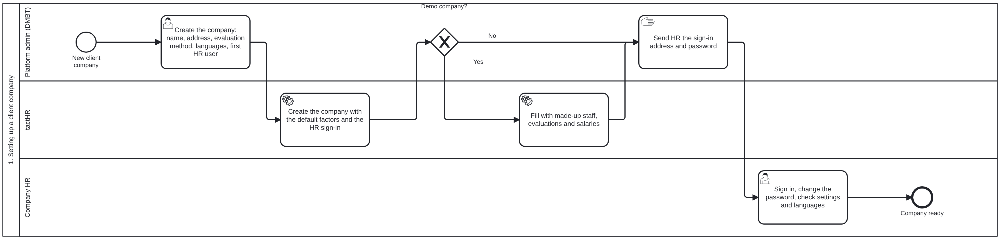
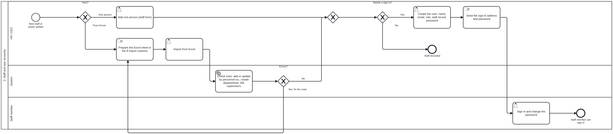
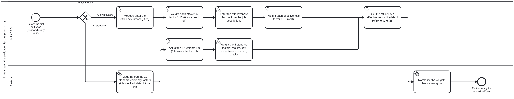
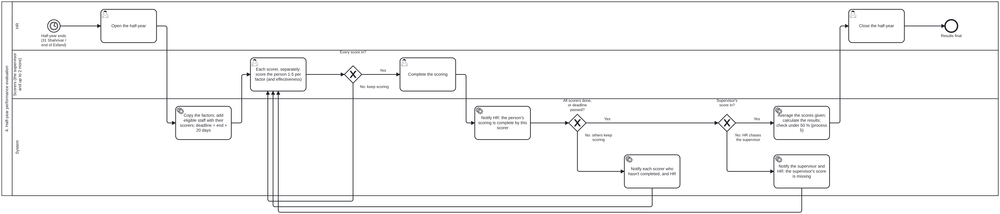
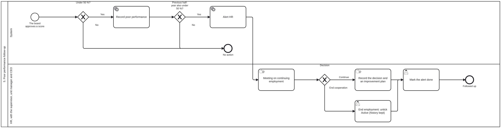
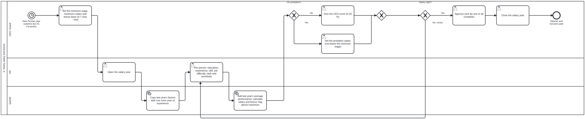

# Processes (BPMN)

The procedures for staff performance evaluation, salary and bonus, drawn in BPMN 2.0. Each `.bpmn` file in
[`bpmn/`](bpmn/) opens in Camunda Modeler, bpmn.io or any BPMN 2.0 tool; the `.png` and `.svg` beside it
are pictures of the same diagram. Lanes show who does each step; gear boxes are steps the system does by
itself, hand boxes are steps done outside the system.

They follow the HR instructions (HR-WI-01, the salary instruction, WI1202) and, for the factors,
specification v1.1 (the [specification summary](PERFORMANCE-SPEC.md)).

<!-- status: kept in the repository, left out of the PDF -->
The diagrams are written by `scripts/docs/bpmn.py` and drawn by `scripts/docs/render.mjs`; change the
script, not the files. Persian versions are in [`bpmn/fa/`](bpmn/fa/) and [`fa/`](fa/); everything is
collected, in English and Persian, in [`procedures-specification-en.pdf`](procedures-specification-en.pdf) and
[`procedures-specification-fa.pdf`](procedures-specification-fa.pdf)
(built by `scripts/docs/pdf.mjs`).
<!-- /status -->

| # | Process | Who | File |
|---|---|---|---|
| 1 | Setting up a client company | System administrator, HR | `p1_company_setup.bpmn` |
| 2 | Staff and user accounts | HR / CEO, staff | `p2_staff_and_users.bpmn` |
| 3 | Setting up the evaluation factors | HR / CEO | `p3_factor_setup.bpmn` |
| 4 | Half-year performance evaluation | HR, scorers (the supervisor and up to two more) | `p4_half_year_evaluation.bpmn` |
| 5 | Poor performance follow-up | HR, supervisor, unit manager, CEO | `p5_poor_performance.bpmn` |
| 6 | Yearly salary and bonus | CEO / board, HR | `p6_salary_and_bonus.bpmn` |

The fields entered at each step are listed in [Data entry, page by page](DATA-ENTRY.md).

## 1. Setting up a client company

1. The system administrator creates the company: name, sign-in address, evaluation mode, languages and
   the first user, who gets the HR role.
2. The system creates the company with the instruction's default factors and the HR sign-in.
3. The administrator sends HR the sign-in address and password.
4. HR signs in, changes the password and checks the settings and languages.

## 2. Staff and user accounts

1. HR adds people one by one, or imports an Excel sheet in the agreed import columns.
2. On import, the system checks every row, adds new people and updates existing ones by personnel
   number, creates missing departments and links supervisors. A row in error stops the import, to be
   fixed and imported again.
3. In each person's profile, HR or the CEO chooses up to three scorers: the person's supervisor (always)
   and up to two more people. Each scores the person separately in every half-year. The second or third
   scorer can also be set for everyone at once: HR chooses the person and whether it applies to all
   active staff or one department; the system sets it for each of them except the scorer themselves.
   Scorers already chosen are kept, and only empty places filled, unless HR ticks *Replace the current
   scorers*.
4. People who need to sign in get a user account: managers and employees are linked to their staff
   record. HR sends them the sign-in address and password; they change the password when they first
   sign in.
5. People who leave are marked inactive, never deleted, so their history stays.

## 3. Setting up the evaluation factors

Following specification v1.1:
- **Mode A (the organization's own factors):** HR enters the efficiency factors and the effectiveness
  factors (from the job descriptions), weighting each from 1 to 10, or 0 to switch it off.
- **Mode B (standard):** the system loads the 12 standard efficiency factors with locked titles; HR
  adjusts their weights (1 to 9, or 0). Effectiveness uses either the 4 standard factors (achieving
  results, key expectations, impact, quality of results), weighted.
- In both modes HR sets the efficiency / effectiveness split (default 50 / 50, e.g. 75 / 25), and the
  system normalizes the weights.

The factors are reviewed every year. Each half-year keeps its own copy, so later changes never alter it.

## 4. Half-year performance evaluation

1. When a half-year ends (31 Shahrivar or the end of Esfand), HR opens it.
2. The system copies the factors, adds everyone eligible (full-time, three months' service by the
   half's end) and sets the deadline 20 days after the half ends.
3. Each of the person's scorers (from their profile: the supervisor and up to two more) scores them
   separately, from 1 to 5 on every factor (and effectiveness), and completes the scoring once every
   score is in.
4. Each time a scorer completes a person's scoring, the system notifies HR: "*person*'s scoring has been
   completed by *scorer*". No approval is needed.
5. Until the deadline, the system notifies each scorer who hasn't completed (and HR), and HR follows it
   up. When all the person's scorers are done, or the deadline has passed, the system averages the scores
   that were given: each factor's score is the average of the scorers who scored it. If one or two of
   the other scorers didn't score, the supervisor's score alone is enough. Without the supervisor's
   score, the system notifies the supervisor and HR, and HR follows it up.
6. The system then calculates the results and checks for two half-years under 50 % (process 5).
7. When everyone's result is in, HR closes the half-year. The results feed the
   reports, the ranking and next year's salary.

Nobody scores themselves. Only the average is the person's result; each scorer's own scores stay on
record for HR.

## 5. Poor performance follow-up

1. When a person's half-year result is under 50 %, the system records poor performance (no bonus that year).
2. If the previous half-year was also under 50 %, the system alerts HR, the supervisor, the unit
   manager and the CEO.
3. HR meets the supervisor, the unit manager and the CEO about continuing the employment.
4. HR records the decision: an improvement plan, or the end of employment (the person is marked
   inactive; their history stays). HR then marks the alert done.

## 6. Yearly salary and bonus

1. At the start of the Persian year the board sets the minimum wage (labour office), the maximum
   salary and the bonus base; A = maximum − minimum. Salaries are due by 31 Farvardin.
2. HR opens the salary year; the system copies last year's factors for everyone, with one more year of
   experience.
3. HR enters or updates each person's education, experience, skill, job difficulty, job rank and
   sensitivity.
4. The system adds last year's average performance (completed half-years), calculates the salary
   (minimum wage + A × the sum of the seven percentages) and the bonus (base × performance coefficient;
   nothing under 50 %), and flags salaries above the maximum.
5. The CEO / board gives the CEO score (0-20 %), or for someone on probation sets the probation salary
   (not below the minimum wage, no bonus).
6. If a salary isn't right, HR revises the factors; otherwise the board approves (one by one or all
   complete) and closes the salary year.
