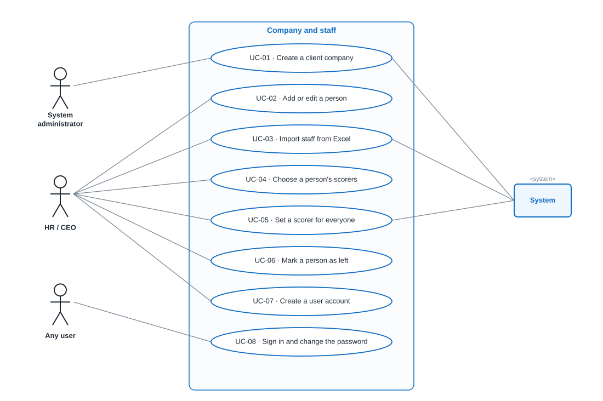
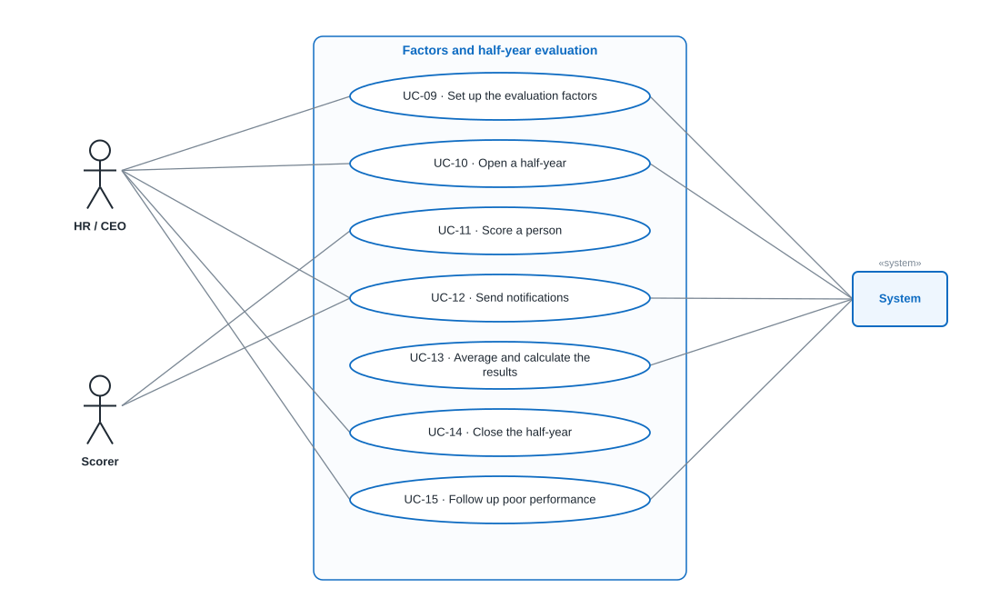
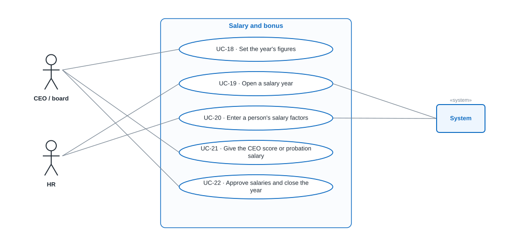
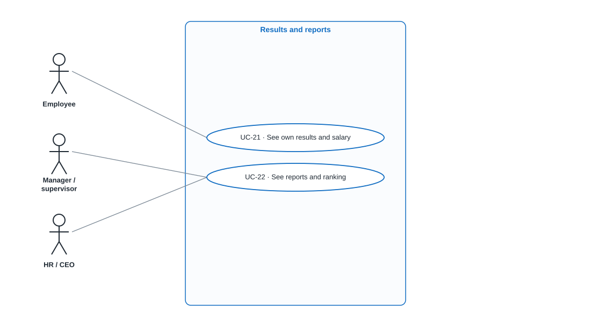

# Use cases

Who uses the system and what for. Each use case has a card: who does it, the goal, what starts it, what
must be true first, the main steps, the alternatives and exceptions, the result, and the process and
page it belongs to ([Processes](PROCESSES.md), [Data entry](DATA-ENTRY.md)).

## Actors
| Actor | Who | Does |
|---|---|---|
| System administrator | The provider's administrator | Creates and suspends client companies |
| HR / CEO | The company's HR, or its CEO | Staff, scorers, users, factors and half-years |
| CEO / board | The CEO or the board | The year's salary figures, the CEO score, probation salaries, salary approval | <!-- salary -->
| Scorer | The person's supervisor (always) and up to two more people chosen in the profile | Scores the people they are a scorer for |
| Manager / supervisor | Anyone with a team | Sees their team's results and reports |
| Employee | Any staff member with a sign-in | Sees their own results |
| Any user | Any of the above | Signs in and changes their password |
| System | The application itself | Checks, copies, calculates, averages and sends notifications and alerts |

## Use case diagrams

 <!-- salary -->

## Company and staff

### UC-01 · Create a client company
| | |
|---|---|
| Actor | System administrator; System |
| Goal | A new client company can start using the system |
| Trigger | A new client signs up |
| Preconditions | The sign-in address isn't used by another company |
| Main steps | 1. The administrator enters the name, sign-in address, evaluation mode (A or B), languages and the first user (name, email, password). 2. The system creates the company with the instruction's default factors and the first user with the HR role. 3. The administrator sends HR the sign-in address and password. |
| Alternatives and exceptions | Sign-in address taken or not valid: the system asks for another. A company can later be suspended: nobody signs in, its data is kept. |
| Result | The company exists with its factors and an HR user |
| Process / page | Process 1 · Data entry 1 |

### UC-02 · Add or edit a person
| | |
|---|---|
| Actor | HR / CEO |
| Goal | Keep a person's staff record complete and correct |
| Trigger | Someone joins, or their details change |
| Preconditions | Signed in as HR or CEO |
| Main steps | 1. HR opens the staff page and adds a person, or chooses the pencil on a row. 2. HR enters or changes the details: names, personnel no., job title, department, supervisor, start date, full-time and the other staff fields. 3. The system checks the fields and saves. |
| Alternatives and exceptions | Personnel no. or national ID already used: refused. A supervisor that would make the person their own supervisor, directly or through others: refused. |
| Result | The person is on the staff list; eligibility for evaluation follows from the start date and full-time |
| Process / page | Process 2 · Data entry 3 |

### UC-03 · Import staff from Excel
| | |
|---|---|
| Actor | HR / CEO; System |
| Goal | Add or update many people at once |
| Trigger | First set-up, or a yearly update |
| Preconditions | An Excel sheet in the agreed import columns |
| Main steps | 1. HR uploads the sheet. 2. The system checks every row, adds new people and updates existing ones by personnel no., creates missing departments and links supervisors. 3. The system reports what was added and updated. |
| Alternatives and exceptions | A row in error stops the import and is shown with its reason; HR fixes the sheet and imports it again. |
| Result | The staff list matches the sheet |
| Process / page | Process 2 · Data entry 3 (Excel import) |

### UC-04 · Choose a person's scorers
| | |
|---|---|
| Actor | HR / CEO |
| Goal | Decide who scores a person |
| Trigger | A person is added, or their scorers change |
| Preconditions | The person has a supervisor |
| Main steps | 1. HR opens the person's profile. 2. The supervisor is the first scorer; HR may choose a second and a third scorer from the active staff. 3. The system saves them. |
| Alternatives and exceptions | The person themselves, or the same person twice: refused. With no second or third scorer, the supervisor alone scores. |
| Result | Up to three scorers on the person's profile, used from the next half-year opened |
| Process / page | Process 2 · Data entry 3 |

### UC-05 · Set a scorer for everyone
| | |
|---|---|
| Actor | HR / CEO; System |
| Goal | Make one person the second (or third) scorer of everyone, or of a department, in one go |
| Trigger | HR wants the same extra scorer across the company or a department |
| Preconditions | The scorer is an active staff member |
| Main steps | 1. HR chooses **Scorer for everyone** on the staff page. 2. HR picks second or third, the scorer, and all active staff or one department, and whether to replace the current scorers. 3. The system sets that scorer for everyone in scope except the scorer themselves. |
| Alternatives and exceptions | Without **Replace the current scorers**, people who already have one keep it and only empty places are filled. |
| Result | The scorer is set on every profile in scope |
| Process / page | Process 2 · Data entry 3 (scorer for everyone) |

### UC-06 · Mark a person as left
| | |
|---|---|
| Actor | HR / CEO |
| Goal | Stop evaluating someone who has left, without losing their history |
| Trigger | A person leaves, or employment ends after poor performance (UC-15) |
| Preconditions | The person is active |
| Main steps | 1. HR edits the person and unticks **Active**. 2. The system keeps all their evaluations. |
| Alternatives and exceptions | — |
| Result | The person is no longer added to new half-years; their history stays in the reports |
| Process / page | Process 2, process 5 · Data entry 3 |

### UC-07 · Create a user account
| | |
|---|---|
| Actor | HR / CEO |
| Goal | Let someone sign in |
| Trigger | A scorer, manager or employee needs to use the system |
| Preconditions | For managers and employees, a staff record without an account |
| Main steps | 1. HR enters the name, email, role, staff record and a password. 2. The system creates the account. 3. HR sends the sign-in address and password. |
| Alternatives and exceptions | Email already used in the company: refused. Nobody can remove their own access. |
| Result | The person can sign in with the rights of their role |
| Process / page | Process 2 · Data entry 4 |

### UC-08 · Sign in and change the password
| | |
|---|---|
| Actor | Any user |
| Goal | Use the system safely |
| Trigger | First sign-in, or whenever the user wants |
| Preconditions | An active account in an active company |
| Main steps | 1. The user opens the company's sign-in address and signs in. 2. On **My account**, the user enters the current password and a new one. |
| Alternatives and exceptions | Wrong email or password: refused. Suspended account or company: no sign-in. |
| Result | The user is signed in with their own password |
| Process / page | Process 2 · Data entry 4 (My account) |

## Factors and half-year evaluation

### UC-09 · Set up the evaluation factors
| | |
|---|---|
| Actor | HR / CEO; System |
| Goal | Decide what people are scored on, and how much each counts |
| Trigger | Before the first half-year, and at the yearly review |
| Preconditions | The company's evaluation mode is set |
| Main steps | 1. Mode A: HR enters the efficiency factors and the effectiveness factors (from the job descriptions) and weights each 1-10. 2. Mode B: the system loads the 12 standard efficiency factors and the 4 standard effectiveness factors; HR adjusts their weights. 3. HR sets the efficiency / effectiveness split (default 50 / 50). 4. The system normalizes the weights and checks every group. |
| Alternatives and exceptions | A weight of 0 leaves a factor out. A group with no factor weighted: refused. **Restore defaults** puts back the instruction's factors. |
| Result | Factors ready for the next half-year; a half-year already open keeps its own copy |
| Process / page | Process 3 · Data entry 5 |

### UC-10 · Open a half-year
| | |
|---|---|
| Actor | HR / CEO; System |
| Goal | Start the evaluation of a half-year |
| Trigger | The half-year ends (31 Shahrivar or the end of Esfand) |
| Preconditions | The half-year has started and isn't open yet; factors are set |
| Main steps | 1. HR chooses the half-year and opens it. 2. The system copies the factors, adds everyone eligible (full-time, three months' service by the half's end) with their scorers, and sets the deadline 20 days after the half ends. |
| Alternatives and exceptions | Someone without a supervisor has no scorer: HR sets one (UC-02, UC-04). |
| Result | Every scorer has the people they score waiting for them |
| Process / page | Process 4 · Data entry 6 |

### UC-11 · Score a person
| | |
|---|---|
| Actor | Scorer |
| Goal | Give a person their scores for the half-year |
| Trigger | A half-year is open |
| Preconditions | The user is one of the person's scorers, and not the person themselves; before the deadline |
| Main steps | 1. The scorer opens the person's scoring form. 2. The scorer gives 1 to 5 on every efficiency and effectiveness factor, reading each option's description, and may add notes. 3. The system shows the efficiency, effectiveness and total scores as the scorer goes. 4. The scorer chooses **Complete**. |
| Alternatives and exceptions | **Save** keeps a draft to finish later. **Complete** needs every score. Each scorer scores separately. |
| Result | This scorer's scoring of the person is complete; HR is notified (UC-12) |
| Process / page | Process 4 · Data entry 6 (scoring form) |

### UC-12 · Send notifications
| | |
|---|---|
| Actor | System; received by HR / CEO and scorers |
| Goal | Keep HR informed and remind whoever still has something to do |
| Trigger | A scoring is completed, or something is missing before the deadline |
| Preconditions | A half-year is open |
| Main steps | 1. When a scorer completes a person's scoring, the system notifies HR: "*person*'s scoring has been completed by *scorer*". 2. Before the deadline, the system notifies each scorer who hasn't completed, and HR. 3. When the scores are due and the supervisor's is missing, the system notifies the supervisor and HR. |
| Alternatives and exceptions | No reminders once a person's result has been calculated. |
| Result | HR sees progress without asking; scorers know what is left |
| Process / page | Process 4 |

### UC-13 · Average and calculate the results
| | |
|---|---|
| Actor | System |
| Goal | Turn the scorers' scores into the person's result |
| Trigger | All the person's scorers are done, or the deadline has passed |
| Preconditions | The supervisor's scoring is complete |
| Main steps | 1. For each factor, the system averages the scores of the scorers who completed. 2. It calculates the efficiency score, the effectiveness score and the total, each 0-100 %. 3. It checks for poor performance (UC-15). |
| Alternatives and exceptions | If one or both of the other scorers didn't score, the supervisor's score alone is used. Without the supervisor's score, no result: the supervisor and HR are notified (UC-12). |
| Result | The person's result for the half-year; each scorer's own scores stay on record for HR |
| Process / page | Process 4 |

### UC-14 · Close the half-year
| | |
|---|---|
| Actor | HR / CEO |
| Goal | Make the half-year's results final |
| Trigger | Everyone's result is in |
| Preconditions | No result missing |
| Main steps | 1. HR checks the half-year's progress. 2. HR closes the half-year. |
| Alternatives and exceptions | Results still missing: HR follows them up first. |
| Result | Results final; they feed the reports and the ranking |
| Process / page | Process 4 · Data entry 6 |

### UC-15 · Follow up poor performance
| | |
|---|---|
| Actor | System; HR / CEO, with the supervisor, unit manager and CEO |
| Goal | Act on a person who performs poorly twice in a row |
| Trigger | A person's half-year result is under 50 % |
| Preconditions | The result has been calculated (UC-13) |
| Main steps | 1. The system records poor performance. 2. If the previous half-year was also under 50 %, the system alerts HR, the supervisor, the unit manager and the CEO. 3. HR holds a meeting on continuing the employment. 4. HR records the decision and marks the alert done. |
| Alternatives and exceptions | Decision to continue: an improvement plan is recorded. Decision to end the employment: the person is marked as left (UC-06). |
| Result | The decision is on record and the alert is closed |
| Process / page | Process 5 |

## Results and reports

### UC-16 · See own results
| | |
|---|---|
| Actor | Employee |
| Goal | Know how they were evaluated |
| Trigger | A half-year is closed |
| Preconditions | Signed in, linked to their staff record |
| Main steps | 1. The employee opens their own page. 2. They see their results per half-year (efficiency, effectiveness, total) and their trend. |
| Alternatives and exceptions | Each scorer's own scores aren't shown, only the average. |
| Result | The employee sees their own results only |
| Process / page | — |

### UC-17 · See reports and ranking
| | |
|---|---|
| Actor | Manager / supervisor; HR / CEO |
| Goal | Compare people and departments over time |
| Trigger | Whenever needed |
| Preconditions | Signed in |
| Main steps | 1. The user opens the reports. 2. They see results by department, each person's trend over the half-years, the ranking by half-year or year, and the scores per factor. |
| Alternatives and exceptions | Managers see only their own team; HR and the CEO see everyone. |
| Result | Results compared across people, departments and half-years |
| Process / page | — |

<!-- salary -->
## Salary and bonus

### UC-18 · Set the year's figures
| | |
|---|---|
| Actor | CEO / board |
| Goal | Fix the figures every salary is calculated from |
| Trigger | The start of the Persian year (salaries due 31 Farvardin) |
| Preconditions | The labour office's minimum wage is known |
| Main steps | 1. The board enters the minimum wage, the maximum salary and the bonus base. 2. The system works out A = maximum − minimum. |
| Alternatives and exceptions | Maximum below the minimum: refused. Changing the figures later needs every salary approved again. |
| Result | The year's figures are set |
| Process / page | Process 6 · Data entry 7 |

### UC-19 · Open a salary year
| | |
|---|---|
| Actor | HR; System |
| Goal | Prepare everyone's salary for the year |
| Trigger | The year's figures are set |
| Preconditions | The year isn't already open |
| Main steps | 1. HR opens the salary year. 2. The system copies each person's salary factors from the year before, with one more year of experience. |
| Alternatives and exceptions | — |
| Result | A salary record for every active person |
| Process / page | Process 6 · Data entry 7 |

### UC-20 · Enter a person's salary factors
| | |
|---|---|
| Actor | HR; System |
| Goal | Have each person's salary calculated correctly |
| Trigger | A salary year is open |
| Preconditions | The person has a salary record |
| Main steps | 1. HR enters or updates education, experience, skill, job difficulty, job rank and sensitivity. 2. The system adds last year's average performance, calculates the salary (minimum wage + A × the sum of the seven percentages) and the bonus (base × performance coefficient), and flags a salary above the maximum. |
| Alternatives and exceptions | A score outside its level's range: refused. Performance under 50 %: no bonus. |
| Result | The person's salary and bonus are calculated |
| Process / page | Process 6 · Data entry 7 (salary form) |

### UC-21 · Give the CEO score or probation salary
| | |
|---|---|
| Actor | CEO / board |
| Goal | Add the CEO's judgement to each salary |
| Trigger | The salaries are calculated |
| Preconditions | The person's salary factors are in |
| Main steps | 1. The CEO gives the CEO score, 0-20 %. 2. The system recalculates the salary. |
| Alternatives and exceptions | Someone on probation: the CEO sets the probation salary instead (not below the minimum wage, no bonus). |
| Result | The salary is complete and ready for approval |
| Process / page | Process 6 · Data entry 7 |

### UC-22 · Approve salaries and close the year
| | |
|---|---|
| Actor | CEO / board |
| Goal | Make the year's salaries and bonuses final |
| Trigger | The salaries are complete |
| Preconditions | Every salary has its factors and CEO score |
| Main steps | 1. The board reviews the salaries. 2. The board approves them one by one, or all complete ones at once. 3. The board closes the salary year. |
| Alternatives and exceptions | A salary isn't right: HR revises its factors (UC-20) and it comes back for approval. |
| Result | Salaries and bonuses final, ready to pay |
| Process / page | Process 6 · Data entry 7 |
<!-- /salary -->
