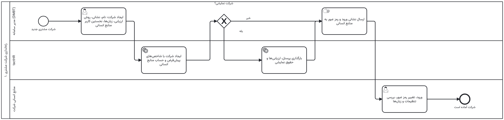
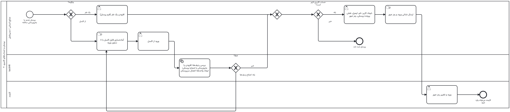
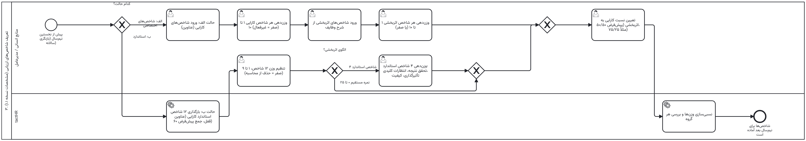

# فرایندهای tactHR (BPMN)

فرایندهای tactHR با استاندارد BPMN 2.0. هر فایل `.bpmn` در پوشه `docs/bpmn/fa/` در Camunda Modeler،
bpmn.io یا هر ابزار BPMN 2.0 باز می‌شود. ستون‌های افقی (lane) نشان می‌دهند هر گام را چه کسی انجام می‌دهد؛
جعبه‌های چرخ‌دنده گام‌هایی است که tactHR خودکار انجام می‌دهد و جعبه‌های دست، کارهایی است که بیرون از
نرم‌افزار انجام می‌شود.

مبنای نمودارها: نرم‌افزار در وضعیت فعلی، دستورالعمل‌های منابع انسانی (HR-WI-01، دستورالعمل تعیین حقوق و
دستمزد، WI1202) و برای شاخص‌ها، مشخصات نسخه ۱.۱.

| # | فرایند | نقش‌ها | فایل |
|---|---|---|---|
| ۱ | راه‌اندازی شرکت مشتری | مدیر سامانه، منابع انسانی | `p1_company_setup.bpmn` |
| ۲ | پرسنل و حساب‌های کاربری | منابع انسانی / مدیرعامل، کارمند | `p2_staff_and_users.bpmn` |
| ۳ | تعریف شاخص‌های ارزیابی | منابع انسانی / مدیرعامل | `p3_factor_setup.bpmn` |
| ۴ | ارزیابی عملکرد نیم‌سالانه | منابع انسانی، سرپرست، مدیر واحد، مدیرعامل / هیئت‌مدیره | `p4_half_year_evaluation.bpmn` |
| ۵ | پیگیری عملکرد نامناسب | منابع انسانی، سرپرست، مدیر واحد، مدیرعامل | `p5_poor_performance.bpmn` |
| ۶ | حقوق و پاداش سالانه | مدیرعامل / هیئت‌مدیره، منابع انسانی | `p6_salary_and_bonus.bpmn` |

## ۱. راه‌اندازی شرکت مشتری

1. مدیر سامانه (DMBT) در صفحه **سامانه** شرکت را ایجاد می‌کند: نام، نشانی ورود، روش ارزیابی، زبان‌ها و
   نخستین کاربر که نقش منابع انسانی می‌گیرد.
2. tactHR شرکت را با شاخص‌های پیش‌فرض دستورالعمل و حساب منابع انسانی ایجاد می‌کند.
3. برای نمایش، مدیر داده نمایشی (پرسنل، سه سال ارزیابی و دو سال حقوقی) بارگذاری می‌کند.
4. مدیر نشانی ورود (`tacthr.dmbtgroup.com/<نشانی>`) و رمز عبور را برای منابع انسانی می‌فرستد؛ منابع انسانی
   وارد می‌شود، رمز را تغییر می‌دهد و تنظیمات را بررسی می‌کند.

## ۲. پرسنل و حساب‌های کاربری

1. منابع انسانی افراد را یکی‌یکی اضافه می‌کند یا فایل اکسل را با ۸ ستون ورود بارگذاری می‌کند.
2. هنگام ورود، tactHR همه ردیف‌ها را بررسی می‌کند، افراد جدید را اضافه و افراد موجود را با شماره پرسنلی
   به‌روز می‌کند، واحدهای جدید را می‌سازد و سرپرستان را متصل می‌کند. ردیف دارای خطا ورود را متوقف می‌کند تا
   اصلاح و دوباره بارگذاری شود.
3. افرادی که باید وارد شوند حساب کاربری می‌گیرند؛ مدیران و کارمندان باید به پرونده پرسنلی خود متصل شوند.
   منابع انسانی نشانی و رمز را می‌فرستد و فرد در نخستین ورود رمز را تغییر می‌دهد.
4. افرادی که جدا می‌شوند غیرفعال می‌شوند و حذف نمی‌شوند تا سوابقشان بماند.

## ۳. تعریف شاخص‌های ارزیابی

مطابق مشخصات نسخه ۱.۱:
- **حالت الف (شاخص‌های اختصاصی):** منابع انسانی شاخص‌های کارایی و اثربخشی (از شرح وظایف) را وارد و هر یک
  را از ۱ تا ۱۰، یا صفر برای غیرفعال‌سازی، وزن‌دهی می‌کند.
- **حالت ب (استاندارد):** tactHR ۱۲ شاخص استاندارد کارایی را با عناوین قفل بارگذاری می‌کند؛ منابع انسانی وزن‌ها را
  (۱ تا ۹ یا صفر) تنظیم می‌کند. اثربخشی با ۴ شاخص استاندارد (تحقق نتیجه، انتظارات کلیدی، تأثیرگذاری،
  کیفیت نتیجه) با وزن، یا با امتیاز مستقیم ۰ تا ۲۵ سنجیده می‌شود.
- در هر دو حالت منابع انسانی نسبت کارایی به اثربخشی را تعیین می‌کند (پیش‌فرض ۵۰/۵۰، مثلاً ۷۵/۲۵) و tactHR
  وزن‌ها را نسبی‌سازی می‌کند.

نرم‌افزار فعلی حالت ب را با امتیاز ۰ تا ۲۵، جمع ثابت وزن‌ها و نسبت ۷۵/۲۵ یا ۵۰/۵۰ پوشش می‌دهد (به بخش
«تفاوت‌ها با نرم‌افزار فعلی» در مشخصات مراجعه کنید).

## ۴. ارزیابی عملکرد نیم‌سالانه

1. با پایان نیم‌سال (۳۱ شهریور یا پایان اسفند) منابع انسانی آن را باز می‌کند.
2. tactHR شاخص‌ها را کپی می‌کند، همه افراد مشمول (تمام‌وقت با ۳ ماه سابقه تا پایان نیم‌سال) را اضافه می‌کند و
   مهلت را ۲۰ روز پس از پایان نیم‌سال قرار می‌دهد.
3. هر سرپرست به اعضای تیم خود برای هر شاخص (و اثربخشی) امتیاز می‌دهد و پس از کامل شدن، ارزیابی را برای
   تأیید می‌فرستد.
4. مدیر واحد (سرپرستِ سرپرست) آن را بررسی می‌کند؛ اگر بالای سرپرست کسی نباشد، مستقیم به هیئت‌مدیره می‌رود.
5. مدیرعامل / هیئت‌مدیره تأیید نهایی را، تک‌به‌تک یا همه موارد در انتظار، انجام می‌دهد. مدیر یا هیئت‌مدیره
   می‌تواند ارزیابی را برای اصلاح به سرپرست بازگرداند.
6. با تأیید، tactHR نتایج را محاسبه و دو نیم‌سال زیر ۵۰٪ را بررسی می‌کند (فرایند ۵).
7. منابع انسانی موارد باقی‌مانده را پیگیری می‌کند و پس از تأیید همه، نیم‌سال را می‌بندد. نتایج در گزارش‌ها،
   رتبه‌بندی و حقوق سال بعد به کار می‌رود.

هیچ‌کس به خودش امتیاز نمی‌دهد و ارزیابی خودش را تأیید نمی‌کند.

## ۵. پیگیری عملکرد نامناسب

1. وقتی هیئت‌مدیره نمره‌ای زیر ۵۰٪ را تأیید می‌کند، tactHR عملکرد نامناسب ثبت می‌کند (بدون پاداش در آن سال).
2. اگر نیم‌سال قبل هم زیر ۵۰٪ بوده، هشداری در صفحه خانه منابع انسانی ظاهر می‌شود.
3. منابع انسانی با سرپرست، مدیر واحد و مدیرعامل درباره ادامه همکاری جلسه می‌گذارد.
4. منابع انسانی تصمیم را ثبت می‌کند: برنامه بهبود، یا پایان همکاری (فرد غیرفعال می‌شود و سوابقش می‌ماند)؛ سپس
   هشدار را انجام‌شده علامت می‌زند.

## ۶. حقوق و پاداش سالانه

1. در آغاز سال، هیئت‌مدیره حداقل دستمزد (اداره کار)، سقف حقوق و مبنای پاداش را تعیین می‌کند؛ A = سقف −
   حداقل. مهلت حقوق‌ها ۳۱ فروردین است.
2. منابع انسانی سال حقوقی را باز می‌کند؛ tactHR شاخص‌های سال قبل هر نفر را با یک سال سابقه بیشتر کپی می‌کند.
3. منابع انسانی تحصیلات، سابقه، مهارت، سختی کار، رتبه و حساسیت شغلی هر نفر را وارد یا به‌روز می‌کند.
4. tactHR میانگین عملکرد سال قبل (نیم‌سال‌های تأییدشده) را اضافه می‌کند، حقوق (حداقل دستمزد + A × جمع هفت
   درصد) و پاداش (مبنا × ضریب عملکرد؛ زیر ۵۰٪ صفر) را محاسبه و حقوق‌های بیش از سقف را مشخص می‌کند.
5. مدیرعامل / هیئت‌مدیره امتیاز مدیرعامل (۰ تا ۲۰٪) را می‌دهد، یا برای فرد در دوره آزمایشی حقوق آزمایشی را
   (نه کمتر از حداقل دستمزد، بدون پاداش) تعیین می‌کند.
6. اگر حقوقی درست نباشد، منابع انسانی شاخص‌ها را اصلاح می‌کند؛ در غیر این صورت هیئت‌مدیره (تک‌به‌تک یا همه
   موارد کامل) تأیید می‌کند و سال حقوقی را می‌بندد.
