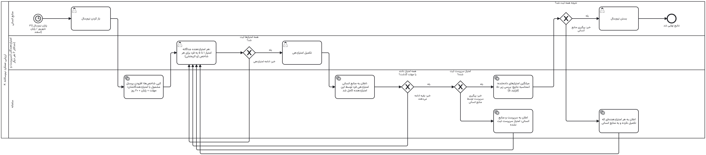
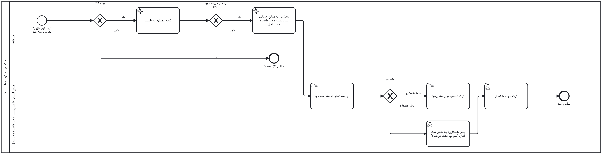
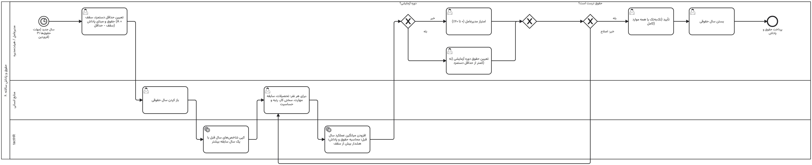

# فرایندها (BPMN)

فرایندهای ارزیابی عملکرد، حقوق و پاداش پرسنل با استاندارد BPMN 2.0. هر فایل `.bpmn` در Camunda Modeler،
bpmn.io یا هر ابزار BPMN 2.0 باز می‌شود. ستون‌های افقی (lane) نشان می‌دهند هر گام را چه کسی انجام می‌دهد؛
جعبه‌های چرخ‌دنده گام‌هایی است که سامانه خودکار انجام می‌دهد و جعبه‌های دست، کارهایی است که بیرون از سامانه
انجام می‌شود.

مبنای نمودارها: دستورالعمل‌های منابع انسانی (HR-WI-01، دستورالعمل تعیین حقوق و دستمزد، WI1202) و برای
شاخص‌ها، مشخصات نسخه ۱.۱.

| # | فرایند | نقش‌ها | فایل |
|---|---|---|---|
| ۱ | راه‌اندازی شرکت مشتری | مدیر سیستم، منابع انسانی | `p1_company_setup.bpmn` |
| ۲ | پرسنل و حساب‌های کاربری | منابع انسانی / مدیرعامل، کارمند | `p2_staff_and_users.bpmn` |
| ۳ | تعریف شاخص‌های ارزیابی | منابع انسانی / مدیرعامل | `p3_factor_setup.bpmn` |
| ۴ | ارزیابی عملکرد نیم‌سالانه | منابع انسانی، امتیازدهندگان (سرپرست و حداکثر دو نفر دیگر) | `p4_half_year_evaluation.bpmn` |
| ۵ | پیگیری عملکرد نامناسب | منابع انسانی، سرپرست، مدیر واحد، مدیرعامل | `p5_poor_performance.bpmn` |
| ۶ | حقوق و پاداش سالانه | مدیرعامل / هیئت‌مدیره، منابع انسانی | `p6_salary_and_bonus.bpmn` |

## ۱. راه‌اندازی شرکت مشتری

1. مدیر سیستم شرکت را ایجاد می‌کند: نام، نشانی ورود، حالت ارزیابی، زبان‌ها و نخستین کاربر که نقش منابع انسانی
   می‌گیرد.
2. سامانه شرکت را با شاخص‌های پیش‌فرض دستورالعمل و حساب منابع انسانی ایجاد می‌کند.
3. مدیر سیستم نشانی ورود و رمز عبور را برای منابع انسانی می‌فرستد.
4. منابع انسانی وارد می‌شود، رمز را تغییر می‌دهد و تنظیمات و زبان‌ها را بررسی می‌کند.

## ۲. پرسنل و حساب‌های کاربری

1. منابع انسانی افراد را یکی‌یکی اضافه می‌کند یا فایل اکسل را با ستون‌های توافق‌شده بارگذاری می‌کند.
2. هنگام ورود، سامانه همه ردیف‌ها را بررسی می‌کند، افراد جدید را اضافه و افراد موجود را با شماره پرسنلی
   به‌روز می‌کند، واحدهای جدید را می‌سازد و سرپرستان را متصل می‌کند. ردیف دارای خطا ورود را متوقف می‌کند تا
   اصلاح و دوباره بارگذاری شود.
3. در پروفایل هر فرد، منابع انسانی یا مدیرعامل حداکثر سه امتیازدهنده انتخاب می‌کند: سرپرست فرد (همیشه) و
   حداکثر دو نفر دیگر. هر کدام در هر نیم‌سال جداگانه به فرد امتیاز می‌دهند.
4. افرادی که باید وارد شوند حساب کاربری می‌گیرند؛ مدیران و کارمندان باید به پرونده پرسنلی خود متصل شوند.
   منابع انسانی نشانی و رمز را می‌فرستد و فرد در نخستین ورود رمز را تغییر می‌دهد.
5. افرادی که جدا می‌شوند غیرفعال می‌شوند و حذف نمی‌شوند تا سوابقشان بماند.

## ۳. تعریف شاخص‌های ارزیابی

مطابق مشخصات نسخه ۱.۱:
- **حالت الف (شاخص‌های اختصاصی):** منابع انسانی شاخص‌های کارایی و اثربخشی (از شرح وظایف) را وارد و هر یک
  را از ۱ تا ۱۰، یا صفر برای غیرفعال‌سازی، وزن‌دهی می‌کند.
- **حالت ب (استاندارد):** سامانه ۱۲ شاخص استاندارد کارایی را با عناوین قفل بارگذاری می‌کند؛ منابع انسانی وزن‌ها را
  (۱ تا ۹ یا صفر) تنظیم می‌کند. اثربخشی با ۴ شاخص استاندارد (تحقق نتیجه، انتظارات کلیدی، تأثیرگذاری،
  کیفیت نتیجه) با وزن، یا با امتیاز مستقیم ۰ تا ۲۵ سنجیده می‌شود.
- در هر دو حالت منابع انسانی نسبت کارایی به اثربخشی را تعیین می‌کند (پیش‌فرض ۵۰/۵۰، مثلاً ۷۵/۲۵) و سامانه
  وزن‌ها را نسبی‌سازی می‌کند.

شاخص‌ها هر سال بازنگری می‌شوند. هر نیم‌سال نسخه خود را نگه می‌دارد تا تغییرات بعدی آن را عوض نکند.

## ۴. ارزیابی عملکرد نیم‌سالانه

1. با پایان نیم‌سال (۳۱ شهریور یا پایان اسفند) منابع انسانی آن را باز می‌کند.
2. سامانه شاخص‌ها را کپی می‌کند، همه افراد مشمول (تمام‌وقت با ۳ ماه سابقه تا پایان نیم‌سال) را اضافه می‌کند و
   مهلت را ۲۰ روز پس از پایان نیم‌سال قرار می‌دهد.
3. هر یک از امتیازدهندگان فرد (طبق پروفایل او: سرپرست و حداکثر دو نفر دیگر) جداگانه از ۱ تا ۵ برای هر شاخص
   (و اثربخشی) امتیاز می‌دهد و پس از ثبت همه امتیازها، امتیازدهی را تکمیل می‌کند.
4. هر بار که امتیازدهنده‌ای امتیازدهی فردی را تکمیل می‌کند، سامانه به منابع انسانی اعلان می‌فرستد: «امتیازدهی
   *فرد* توسط *امتیازدهنده* کامل شد». هیچ تأییدی لازم نیست.
5. وقتی همه امتیازدهندگان فرد امتیاز دادند یا مهلت گذشت، سامانه از امتیازهای داده‌شده میانگین می‌گیرد: امتیاز
   هر شاخص میانگین امتیاز کسانی است که به آن امتیاز داده‌اند. اگر یک یا دو امتیازدهنده دیگر امتیاز نداده باشند،
   امتیاز سرپرست به‌تنهایی کافی است. اگر امتیاز سرپرست ثبت نشده باشد، سامانه به سرپرست و منابع انسانی اعلان
   می‌فرستد و منابع انسانی پیگیری می‌کند.
6. سپس سامانه نتایج را محاسبه و دو نیم‌سال زیر ۵۰٪ را بررسی می‌کند (فرایند ۵).
7. برای موارد باقی‌مانده، سامانه به هر امتیازدهنده‌ای که تکمیل نکرده (و به منابع انسانی) اعلان می‌فرستد و منابع انسانی
   پیگیری می‌کند؛ پس از ثبت نتیجه همه، منابع انسانی نیم‌سال را می‌بندد. نتایج در گزارش‌ها،
   رتبه‌بندی و حقوق سال بعد به کار می‌رود.

هیچ‌کس به خودش امتیاز نمی‌دهد. نتیجه فرد فقط میانگین است؛ امتیازهای هر امتیازدهنده برای منابع انسانی
نگه داشته می‌شود.

## ۵. پیگیری عملکرد نامناسب

1. وقتی نتیجه نیم‌سال فردی زیر ۵۰٪ باشد، سامانه عملکرد نامناسب ثبت می‌کند (بدون پاداش در آن سال).
2. اگر نیم‌سال قبل هم زیر ۵۰٪ بوده، سامانه به منابع انسانی، سرپرست، مدیر واحد و مدیرعامل هشدار می‌دهد.
3. منابع انسانی با سرپرست، مدیر واحد و مدیرعامل درباره ادامه همکاری جلسه می‌گذارد.
4. منابع انسانی تصمیم را ثبت می‌کند: برنامه بهبود، یا پایان همکاری (فرد غیرفعال می‌شود و سوابقش می‌ماند)؛ سپس
   هشدار را انجام‌شده علامت می‌زند.

## ۶. حقوق و پاداش سالانه

1. در آغاز سال، هیئت‌مدیره حداقل دستمزد (اداره کار)، سقف حقوق و مبنای پاداش را تعیین می‌کند؛ A = سقف −
   حداقل. مهلت حقوق‌ها ۳۱ فروردین است.
2. منابع انسانی سال حقوقی را باز می‌کند؛ سامانه شاخص‌های سال قبل هر نفر را با یک سال سابقه بیشتر کپی می‌کند.
3. منابع انسانی تحصیلات، سابقه، مهارت، سختی کار، رتبه و حساسیت شغلی هر نفر را وارد یا به‌روز می‌کند.
4. سامانه میانگین عملکرد سال قبل (نیم‌سال‌های تکمیل‌شده) را اضافه می‌کند، حقوق (حداقل دستمزد + A × جمع هفت
   درصد) و پاداش (مبنا × ضریب عملکرد؛ زیر ۵۰٪ صفر) را محاسبه و حقوق‌های بیش از سقف را مشخص می‌کند.
5. مدیرعامل / هیئت‌مدیره امتیاز مدیرعامل (۰ تا ۲۰٪) را می‌دهد، یا برای فرد در دوره آزمایشی حقوق آزمایشی را
   (نه کمتر از حداقل دستمزد، بدون پاداش) تعیین می‌کند.
6. اگر حقوقی درست نباشد، منابع انسانی شاخص‌ها را اصلاح می‌کند؛ در غیر این صورت هیئت‌مدیره (تک‌به‌تک یا همه
   موارد کامل) تأیید می‌کند و سال حقوقی را می‌بندد.
