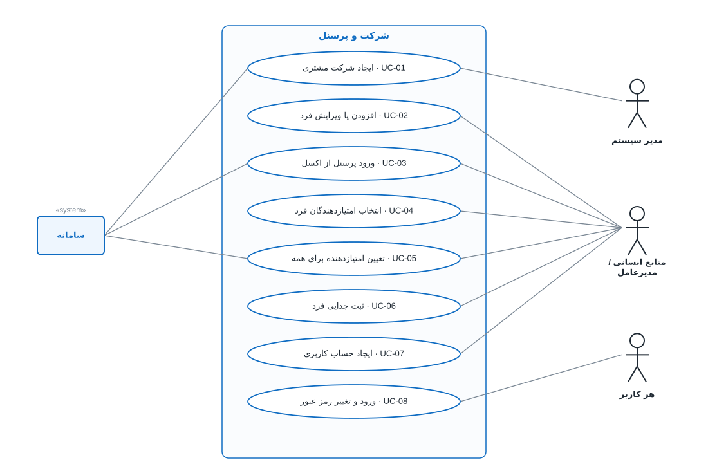
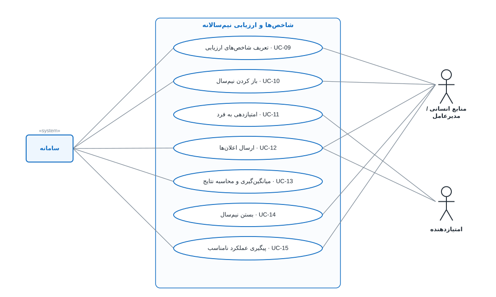
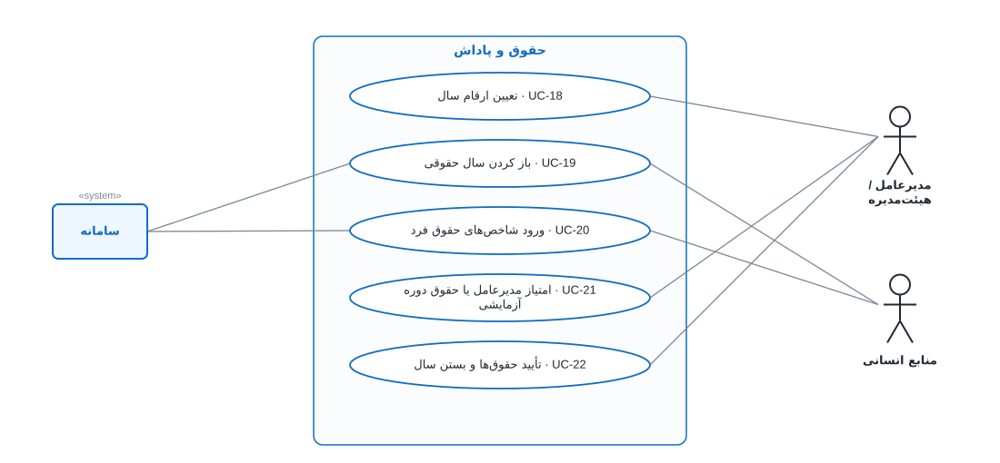
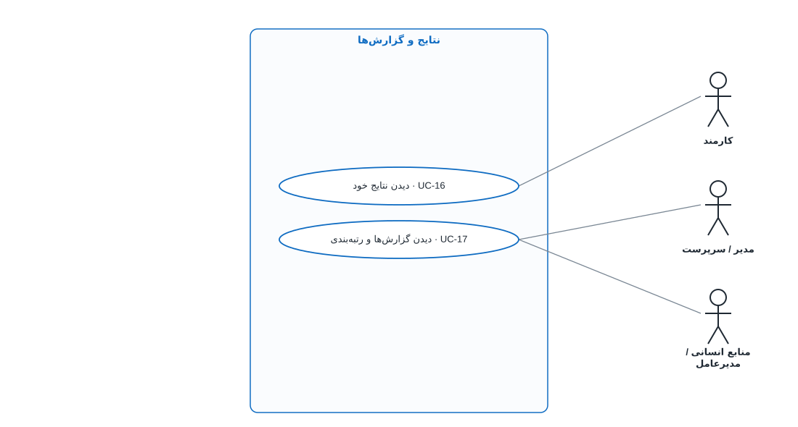

# موارد کاربرد

چه کسانی از سامانه استفاده می‌کنند و برای چه. هر مورد کاربرد یک کارت دارد: چه کسی انجام می‌دهد، هدف، رویداد
آغازگر، پیش‌شرط‌ها، گام‌های اصلی، حالت‌های جایگزین و استثناها، نتیجه، و فرایند و صفحه مربوط
([فرایندها](PROCESSES.md)، [ورود داده](DATA-ENTRY.md)).

## نقش‌ها
| نقش | چه کسی | چه می‌کند |
|---|---|---|
| مدیر سیستم | مدیر سیستم ارائه‌دهنده | ایجاد و تعلیق شرکت‌های مشتری |
| منابع انسانی / مدیرعامل | منابع انسانی شرکت یا مدیرعامل | پرسنل، امتیازدهندگان، کاربران، شاخص‌ها، نیم‌سال‌ها و شاخص‌های حقوق |
| مدیرعامل / هیئت‌مدیره | مدیرعامل یا هیئت‌مدیره | ارقام حقوق سال، امتیاز مدیرعامل، حقوق دوره آزمایشی، تأیید حقوق‌ها |
| امتیازدهنده | سرپرست فرد (همیشه) و حداکثر دو نفر دیگر که در پروفایل تعیین می‌شوند | امتیازدهی به افرادی که امتیازدهنده آن‌هاست |
| مدیر / سرپرست | هر کسی که تیم دارد | دیدن نتایج و گزارش‌های تیم خود |
| کارمند | هر فرد دارای حساب کاربری | دیدن نتایج و حقوق خود |
| هر کاربر | هر یک از نقش‌های بالا | ورود و تغییر رمز عبور |
| سامانه | خود نرم‌افزار | بررسی، کپی، محاسبه، میانگین‌گیری و ارسال اعلان و هشدار |

## نمودارهای موارد کاربرد

## شرکت و پرسنل

### UC-01 · ایجاد شرکت مشتری
| | |
|---|---|
| نقش | مدیر سیستم؛ سامانه |
| هدف | شرکت مشتری جدید بتواند از سامانه استفاده کند |
| آغازگر | ثبت‌نام مشتری جدید |
| پیش‌شرط | نشانی ورود متعلق به شرکت دیگری نباشد |
| گام‌های اصلی | ۱. مدیر سیستم نام، نشانی ورود، حالت ارزیابی (الف یا ب)، زبان‌ها و نخستین کاربر (نام، ایمیل، رمز عبور) را وارد می‌کند. ۲. سامانه شرکت را با شاخص‌های پیش‌فرض دستورالعمل و نخستین کاربر را با نقش منابع انسانی ایجاد می‌کند. ۳. مدیر سیستم نشانی ورود و رمز عبور را برای منابع انسانی می‌فرستد. |
| جایگزین‌ها و استثناها | نشانی ورود تکراری یا نامعتبر: سامانه نشانی دیگری می‌خواهد. شرکت را می‌توان بعداً معلق کرد: کسی وارد نمی‌شود و داده‌ها حفظ می‌شود. |
| نتیجه | شرکت با شاخص‌ها و یک کاربر منابع انسانی ایجاد شده است |
| فرایند / صفحه | فرایند ۱ · ورود داده ۱ |

### UC-02 · افزودن یا ویرایش فرد
| | |
|---|---|
| نقش | منابع انسانی / مدیرعامل |
| هدف | کامل و درست بودن پرونده پرسنلی فرد |
| آغازگر | استخدام فرد یا تغییر اطلاعات او |
| پیش‌شرط | ورود با نقش منابع انسانی یا مدیرعامل |
| گام‌های اصلی | ۱. منابع انسانی در صفحه پرسنل فرد جدید اضافه می‌کند یا مداد یک ردیف را می‌زند. ۲. منابع انسانی اطلاعات را وارد یا اصلاح می‌کند: نام‌ها، شماره پرسنلی، سمت، واحد، سرپرست، تاریخ شروع به کار، تمام‌وقت و سایر فیلدها. ۳. سامانه فیلدها را بررسی و ذخیره می‌کند. |
| جایگزین‌ها و استثناها | شماره پرسنلی یا کد ملی تکراری: پذیرفته نمی‌شود. سرپرستی که فرد را مستقیم یا غیرمستقیم سرپرست خودش کند: پذیرفته نمی‌شود. |
| نتیجه | فرد در فهرست پرسنل است؛ مشمولیت ارزیابی از تاریخ شروع به کار و تمام‌وقت بودن به دست می‌آید |
| فرایند / صفحه | فرایند ۲ · ورود داده ۳ |

### UC-03 · ورود پرسنل از اکسل
| | |
|---|---|
| نقش | منابع انسانی / مدیرعامل؛ سامانه |
| هدف | افزودن یا به‌روزرسانی تعداد زیادی فرد به‌یک‌باره |
| آغازگر | راه‌اندازی اولیه یا به‌روزرسانی سالانه |
| پیش‌شرط | فایل اکسل با ستون‌های توافق‌شده |
| گام‌های اصلی | ۱. منابع انسانی فایل را بارگذاری می‌کند. ۲. سامانه همه ردیف‌ها را بررسی می‌کند، افراد جدید را اضافه و افراد موجود را با شماره پرسنلی به‌روز می‌کند، واحدهای جدید را می‌سازد و سرپرستان را متصل می‌کند. ۳. سامانه گزارش افزوده‌ها و به‌روزشده‌ها را نشان می‌دهد. |
| جایگزین‌ها و استثناها | ردیف دارای خطا ورود را متوقف می‌کند و با دلیلش نمایش داده می‌شود؛ منابع انسانی فایل را اصلاح و دوباره بارگذاری می‌کند. |
| نتیجه | فهرست پرسنل با فایل یکسان است |
| فرایند / صفحه | فرایند ۲ · ورود داده ۳ (ورود از اکسل) |

### UC-04 · انتخاب امتیازدهندگان فرد
| | |
|---|---|
| نقش | منابع انسانی / مدیرعامل |
| هدف | تعیین اینکه چه کسانی به فرد امتیاز می‌دهند |
| آغازگر | افزودن فرد یا تغییر امتیازدهندگان او |
| پیش‌شرط | فرد سرپرست داشته باشد |
| گام‌های اصلی | ۱. منابع انسانی پروفایل فرد را باز می‌کند. ۲. سرپرست امتیازدهنده اول است؛ منابع انسانی می‌تواند امتیازدهنده دوم و سوم را از پرسنل فعال انتخاب کند. ۳. سامانه آن‌ها را ذخیره می‌کند. |
| جایگزین‌ها و استثناها | خود فرد یا انتخاب تکراری یک نفر: پذیرفته نمی‌شود. بدون امتیازدهنده دوم و سوم، سرپرست به‌تنهایی امتیاز می‌دهد. |
| نتیجه | حداکثر سه امتیازدهنده در پروفایل فرد، از نیم‌سال بعدی که باز شود |
| فرایند / صفحه | فرایند ۲ · ورود داده ۳ |

### UC-05 · تعیین امتیازدهنده برای همه
| | |
|---|---|
| نقش | منابع انسانی / مدیرعامل؛ سامانه |
| هدف | یک نفر را یک‌جا امتیازدهنده دوم (یا سوم) همه یا یک واحد کردن |
| آغازگر | منابع انسانی امتیازدهنده اضافه یکسانی برای کل شرکت یا یک واحد می‌خواهد |
| پیش‌شرط | امتیازدهنده جزو پرسنل فعال باشد |
| گام‌های اصلی | ۱. منابع انسانی در صفحه پرسنل **امتیازدهنده برای همه** را انتخاب می‌کند. ۲. منابع انسانی دوم یا سوم، امتیازدهنده، همه پرسنل فعال یا یک واحد، و جایگزینی یا عدم جایگزینی امتیازدهندگان فعلی را تعیین می‌کند. ۳. سامانه آن امتیازدهنده را برای همه افراد دامنه به جز خودش ثبت می‌کند. |
| جایگزین‌ها و استثناها | بدون تیک **جایگزینی امتیازدهندگان فعلی**، افرادی که امتیازدهنده دارند همان را نگه می‌دارند و فقط جاهای خالی پر می‌شود. |
| نتیجه | امتیازدهنده در پروفایل همه افراد دامنه ثبت شده است |
| فرایند / صفحه | فرایند ۲ · ورود داده ۳ (امتیازدهنده برای همه) |

### UC-06 · ثبت جدایی فرد
| | |
|---|---|
| نقش | منابع انسانی / مدیرعامل |
| هدف | توقف ارزیابی فردی که جدا شده، بدون از دست رفتن سوابق |
| آغازگر | جدایی فرد، یا پایان همکاری پس از عملکرد نامناسب (UC-15) |
| پیش‌شرط | فرد فعال باشد |
| گام‌های اصلی | ۱. منابع انسانی فرد را ویرایش و تیک **فعال** را برمی‌دارد. ۲. سامانه همه ارزیابی‌ها و حقوق‌های او را نگه می‌دارد. |
| جایگزین‌ها و استثناها | — |
| نتیجه | فرد به نیم‌سال‌ها و سال‌های حقوقی جدید اضافه نمی‌شود؛ سوابقش در گزارش‌ها می‌ماند |
| فرایند / صفحه | فرایند ۲، فرایند ۵ · ورود داده ۳ |

### UC-07 · ایجاد حساب کاربری
| | |
|---|---|
| نقش | منابع انسانی / مدیرعامل |
| هدف | امکان ورود فرد به سامانه |
| آغازگر | امتیازدهنده، مدیر یا کارمندی که باید از سامانه استفاده کند |
| پیش‌شرط | برای مدیران و کارمندان، پرونده پرسنلی بدون حساب کاربری |
| گام‌های اصلی | ۱. منابع انسانی نام، ایمیل، نقش، پرونده پرسنلی و رمز عبور را وارد می‌کند. ۲. سامانه حساب را ایجاد می‌کند. ۳. منابع انسانی نشانی ورود و رمز عبور را می‌فرستد. |
| جایگزین‌ها و استثناها | ایمیل تکراری در شرکت: پذیرفته نمی‌شود. هیچ‌کس نمی‌تواند دسترسی خودش را بردارد. |
| نتیجه | فرد با دسترسی‌های نقش خود وارد می‌شود |
| فرایند / صفحه | فرایند ۲ · ورود داده ۴ |

### UC-08 · ورود و تغییر رمز عبور
| | |
|---|---|
| نقش | هر کاربر |
| هدف | استفاده امن از سامانه |
| آغازگر | نخستین ورود، یا هر زمان که کاربر بخواهد |
| پیش‌شرط | حساب فعال در شرکت فعال |
| گام‌های اصلی | ۱. کاربر نشانی ورود شرکت را باز می‌کند و وارد می‌شود. ۲. در **حساب من**، رمز فعلی و رمز جدید را وارد می‌کند. |
| جایگزین‌ها و استثناها | ایمیل یا رمز اشتباه: پذیرفته نمی‌شود. حساب یا شرکت معلق: امکان ورود نیست. |
| نتیجه | کاربر با رمز خود وارد شده است |
| فرایند / صفحه | فرایند ۲ · ورود داده ۴ (حساب من) |

## شاخص‌ها و ارزیابی نیم‌سالانه

### UC-09 · تعریف شاخص‌های ارزیابی
| | |
|---|---|
| نقش | منابع انسانی / مدیرعامل؛ سامانه |
| هدف | تعیین اینکه افراد بر چه اساسی و با چه وزنی امتیاز می‌گیرند |
| آغازگر | پیش از نخستین نیم‌سال، و در بازنگری سالانه |
| پیش‌شرط | حالت ارزیابی شرکت تعیین شده باشد |
| گام‌های اصلی | ۱. حالت الف: منابع انسانی شاخص‌های کارایی و اثربخشی (از شرح وظایف) را وارد و هر یک را از ۱ تا ۱۰ وزن‌دهی می‌کند. ۲. حالت ب: سامانه ۱۲ شاخص استاندارد کارایی و ۴ شاخص استاندارد اثربخشی را بارگذاری می‌کند؛ منابع انسانی وزن‌ها را تنظیم می‌کند. ۳. منابع انسانی نسبت کارایی به اثربخشی را تعیین می‌کند (پیش‌فرض ۵۰/۵۰). ۴. سامانه وزن‌ها را نسبی‌سازی و هر گروه را بررسی می‌کند. |
| جایگزین‌ها و استثناها | وزن صفر شاخص را از محاسبه کنار می‌گذارد. گروهی که هیچ شاخص وزن‌داری ندارد: پذیرفته نمی‌شود. **بازگرداندن پیش‌فرض‌ها** شاخص‌های دستورالعمل را برمی‌گرداند. |
| نتیجه | شاخص‌ها برای نیم‌سال بعد آماده است؛ نیم‌سال باز نسخه خود را نگه می‌دارد |
| فرایند / صفحه | فرایند ۳ · ورود داده ۵ |

### UC-10 · باز کردن نیم‌سال
| | |
|---|---|
| نقش | منابع انسانی / مدیرعامل؛ سامانه |
| هدف | آغاز ارزیابی یک نیم‌سال |
| آغازگر | پایان نیم‌سال (۳۱ شهریور یا پایان اسفند) |
| پیش‌شرط | نیم‌سال شروع شده و هنوز باز نشده باشد؛ شاخص‌ها تعیین شده باشند |
| گام‌های اصلی | ۱. منابع انسانی نیم‌سال را انتخاب و باز می‌کند. ۲. سامانه شاخص‌ها را کپی می‌کند، همه افراد مشمول (تمام‌وقت با ۳ ماه سابقه تا پایان نیم‌سال) را با امتیازدهندگانشان اضافه می‌کند و مهلت را ۲۰ روز پس از پایان نیم‌سال قرار می‌دهد. |
| جایگزین‌ها و استثناها | فرد بدون سرپرست امتیازدهنده ندارد: منابع انسانی سرپرست تعیین می‌کند (UC-02، UC-04). |
| نتیجه | هر امتیازدهنده افرادی را که باید امتیاز دهد در انتظار خود می‌بیند |
| فرایند / صفحه | فرایند ۴ · ورود داده ۶ |

### UC-11 · امتیازدهی به فرد
| | |
|---|---|
| نقش | امتیازدهنده |
| هدف | دادن امتیاز نیم‌سال به فرد |
| آغازگر | باز بودن نیم‌سال |
| پیش‌شرط | کاربر یکی از امتیازدهندگان فرد باشد و خود او نباشد؛ پیش از پایان مهلت |
| گام‌های اصلی | ۱. امتیازدهنده فرم امتیازدهی فرد را باز می‌کند. ۲. به هر شاخص کارایی و اثربخشی از ۱ تا ۵ امتیاز می‌دهد (با خواندن توضیح هر گزینه) و در صورت نیاز توضیح می‌نویسد. ۳. سامانه در حین امتیازدهی نمره کارایی، اثربخشی و کل را نشان می‌دهد. ۴. امتیازدهنده **تکمیل** را می‌زند. |
| جایگزین‌ها و استثناها | **ذخیره** پیش‌نویس را برای تکمیل بعدی نگه می‌دارد. **تکمیل** همه امتیازها را لازم دارد. هر امتیازدهنده جداگانه امتیاز می‌دهد. |
| نتیجه | امتیازدهی این امتیازدهنده برای فرد کامل است؛ به منابع انسانی اعلان می‌رود (UC-12) |
| فرایند / صفحه | فرایند ۴ · ورود داده ۶ (فرم امتیازدهی) |

### UC-12 · ارسال اعلان‌ها
| | |
|---|---|
| نقش | سامانه؛ گیرندگان: منابع انسانی / مدیرعامل و امتیازدهندگان |
| هدف | آگاه نگه داشتن منابع انسانی و یادآوری به کسانی که کاری باقی دارند |
| آغازگر | تکمیل یک امتیازدهی، یا کمبودی پیش از پایان مهلت |
| پیش‌شرط | باز بودن نیم‌سال |
| گام‌های اصلی | ۱. وقتی امتیازدهنده‌ای امتیازدهی فردی را تکمیل می‌کند، سامانه به منابع انسانی اعلان می‌دهد: «امتیازدهی *فرد* توسط *امتیازدهنده* کامل شد». ۲. پیش از پایان مهلت، سامانه به هر امتیازدهنده‌ای که تکمیل نکرده و به منابع انسانی اعلان می‌دهد. ۳. اگر زمان امتیازها رسیده و امتیاز سرپرست ثبت نشده باشد، سامانه به سرپرست و منابع انسانی اعلان می‌دهد. |
| جایگزین‌ها و استثناها | پس از محاسبه نتیجه فرد، یادآوری برای او فرستاده نمی‌شود. |
| نتیجه | منابع انسانی بدون پرسیدن از پیشرفت کار آگاه است؛ امتیازدهندگان کار باقی‌مانده را می‌دانند |
| فرایند / صفحه | فرایند ۴ |

### UC-13 · میانگین‌گیری و محاسبه نتایج
| | |
|---|---|
| نقش | سامانه |
| هدف | تبدیل امتیازهای امتیازدهندگان به نتیجه فرد |
| آغازگر | همه امتیازدهندگان فرد امتیاز داده‌اند یا مهلت گذشته است |
| پیش‌شرط | امتیازدهی سرپرست کامل باشد |
| گام‌های اصلی | ۱. سامانه برای هر شاخص، میانگین امتیاز کسانی را که تکمیل کرده‌اند می‌گیرد. ۲. نمره کارایی، اثربخشی و کل را، هر کدام از ۰ تا ۱۰۰٪، محاسبه می‌کند. ۳. عملکرد نامناسب را بررسی می‌کند (UC-15). |
| جایگزین‌ها و استثناها | اگر یک یا هر دو امتیازدهنده دیگر امتیاز نداده باشند، امتیاز سرپرست به‌تنهایی به کار می‌رود. بدون امتیاز سرپرست، نتیجه‌ای محاسبه نمی‌شود و به سرپرست و منابع انسانی اعلان می‌رود (UC-12). |
| نتیجه | نتیجه نیم‌سال فرد؛ امتیازهای هر امتیازدهنده برای منابع انسانی نگه داشته می‌شود |
| فرایند / صفحه | فرایند ۴ |

### UC-14 · بستن نیم‌سال
| | |
|---|---|
| نقش | منابع انسانی / مدیرعامل |
| هدف | نهایی کردن نتایج نیم‌سال |
| آغازگر | ثبت نتیجه همه افراد |
| پیش‌شرط | هیچ نتیجه‌ای ناقص نباشد |
| گام‌های اصلی | ۱. منابع انسانی پیشرفت نیم‌سال را بررسی می‌کند. ۲. منابع انسانی نیم‌سال را می‌بندد. |
| جایگزین‌ها و استثناها | اگر نتیجه‌ای ناقص باشد، منابع انسانی ابتدا آن را پیگیری می‌کند. |
| نتیجه | نتایج نهایی است و در گزارش‌ها، رتبه‌بندی و حقوق سال بعد به کار می‌رود |
| فرایند / صفحه | فرایند ۴ · ورود داده ۶ |

### UC-15 · پیگیری عملکرد نامناسب
| | |
|---|---|
| نقش | سامانه؛ منابع انسانی / مدیرعامل، با سرپرست، مدیر واحد و مدیرعامل |
| هدف | اقدام درباره فردی که دو نیم‌سال پیاپی عملکرد نامناسب دارد |
| آغازگر | نتیجه نیم‌سال فرد زیر ۵۰٪ باشد |
| پیش‌شرط | نتیجه محاسبه شده باشد (UC-13) |
| گام‌های اصلی | ۱. سامانه عملکرد نامناسب ثبت می‌کند (بدون پاداش در آن سال). ۲. اگر نیم‌سال قبل هم زیر ۵۰٪ بوده، سامانه به منابع انسانی، سرپرست، مدیر واحد و مدیرعامل هشدار می‌دهد. ۳. منابع انسانی درباره ادامه همکاری جلسه می‌گذارد. ۴. منابع انسانی تصمیم را ثبت و هشدار را انجام‌شده علامت می‌زند. |
| جایگزین‌ها و استثناها | تصمیم به ادامه همکاری: برنامه بهبود ثبت می‌شود. تصمیم به پایان همکاری: جدایی فرد ثبت می‌شود (UC-06). |
| نتیجه | تصمیم ثبت شده و هشدار بسته شده است |
| فرایند / صفحه | فرایند ۵ |

## حقوق و پاداش

### UC-16 · تعیین ارقام سال
| | |
|---|---|
| نقش | مدیرعامل / هیئت‌مدیره |
| هدف | تعیین ارقامی که همه حقوق‌ها بر اساس آن محاسبه می‌شود |
| آغازگر | آغاز سال (مهلت حقوق‌ها ۳۱ فروردین) |
| پیش‌شرط | حداقل دستمزد اداره کار اعلام شده باشد |
| گام‌های اصلی | ۱. هیئت‌مدیره حداقل دستمزد، سقف حقوق و مبنای پاداش را وارد می‌کند. ۲. سامانه A = سقف − حداقل را محاسبه می‌کند. |
| جایگزین‌ها و استثناها | سقف کمتر از حداقل: پذیرفته نمی‌شود. تغییر بعدی ارقام، تأیید دوباره همه حقوق‌ها را لازم دارد. |
| نتیجه | ارقام سال تعیین شده است |
| فرایند / صفحه | فرایند ۶ · ورود داده ۷ |

### UC-17 · باز کردن سال حقوقی
| | |
|---|---|
| نقش | منابع انسانی؛ سامانه |
| هدف | آماده کردن حقوق همه افراد برای سال |
| آغازگر | تعیین ارقام سال |
| پیش‌شرط | سال از قبل باز نشده باشد |
| گام‌های اصلی | ۱. منابع انسانی سال حقوقی را باز می‌کند. ۲. سامانه شاخص‌های حقوق هر فرد را از سال قبل با یک سال سابقه بیشتر کپی می‌کند. |
| جایگزین‌ها و استثناها | — |
| نتیجه | برای هر فرد فعال یک رکورد حقوق ایجاد شده است |
| فرایند / صفحه | فرایند ۶ · ورود داده ۷ |

### UC-18 · ورود شاخص‌های حقوق فرد
| | |
|---|---|
| نقش | منابع انسانی؛ سامانه |
| هدف | محاسبه درست حقوق هر فرد |
| آغازگر | باز بودن سال حقوقی |
| پیش‌شرط | فرد رکورد حقوق داشته باشد |
| گام‌های اصلی | ۱. منابع انسانی تحصیلات، سابقه، مهارت، سختی کار، رتبه و حساسیت شغلی را وارد یا به‌روز می‌کند. ۲. سامانه میانگین عملکرد سال قبل را اضافه می‌کند، حقوق (حداقل دستمزد + A × جمع هفت درصد) و پاداش (مبنا × ضریب عملکرد) را محاسبه و حقوق بیش از سقف را مشخص می‌کند. |
| جایگزین‌ها و استثناها | امتیاز خارج از بازه سطح: پذیرفته نمی‌شود. عملکرد زیر ۵۰٪: بدون پاداش. |
| نتیجه | حقوق و پاداش فرد محاسبه شده است |
| فرایند / صفحه | فرایند ۶ · ورود داده ۷ (فرم حقوق) |

### UC-19 · امتیاز مدیرعامل یا حقوق دوره آزمایشی
| | |
|---|---|
| نقش | مدیرعامل / هیئت‌مدیره |
| هدف | افزودن نظر مدیرعامل به هر حقوق |
| آغازگر | محاسبه حقوق‌ها |
| پیش‌شرط | شاخص‌های حقوق فرد وارد شده باشد |
| گام‌های اصلی | ۱. مدیرعامل امتیاز مدیرعامل را از ۰ تا ۲۰٪ می‌دهد. ۲. سامانه حقوق را دوباره محاسبه می‌کند. |
| جایگزین‌ها و استثناها | فرد در دوره آزمایشی: مدیرعامل به‌جای آن حقوق دوره آزمایشی را تعیین می‌کند (نه کمتر از حداقل دستمزد، بدون پاداش). |
| نتیجه | حقوق کامل و آماده تأیید است |
| فرایند / صفحه | فرایند ۶ · ورود داده ۷ |

### UC-20 · تأیید حقوق‌ها و بستن سال
| | |
|---|---|
| نقش | مدیرعامل / هیئت‌مدیره |
| هدف | نهایی کردن حقوق و پاداش سال |
| آغازگر | کامل شدن حقوق‌ها |
| پیش‌شرط | هر حقوق شاخص‌ها و امتیاز مدیرعامل را داشته باشد |
| گام‌های اصلی | ۱. هیئت‌مدیره حقوق‌ها را بررسی می‌کند. ۲. هیئت‌مدیره آن‌ها را تک‌به‌تک، یا همه موارد کامل را یک‌جا، تأیید می‌کند. ۳. هیئت‌مدیره سال حقوقی را می‌بندد. |
| جایگزین‌ها و استثناها | حقوقی درست نیست: منابع انسانی شاخص‌های آن را اصلاح می‌کند (UC-18) و دوباره برای تأیید می‌آید. |
| نتیجه | حقوق و پاداش‌ها نهایی و آماده پرداخت است |
| فرایند / صفحه | فرایند ۶ · ورود داده ۷ |

## نتایج و گزارش‌ها

### UC-21 · دیدن نتایج و حقوق خود
| | |
|---|---|
| نقش | کارمند |
| هدف | آگاهی از نتیجه ارزیابی و حقوق خود |
| آغازگر | بسته شدن نیم‌سال یا تأیید سال حقوقی |
| پیش‌شرط | ورود به سامانه، متصل به پرونده پرسنلی خود |
| گام‌های اصلی | ۱. کارمند صفحه خود را باز می‌کند. ۲. نتایج هر نیم‌سال (کارایی، اثربخشی، کل) و روند آن، و حقوق و پاداش تأییدشده خود را می‌بیند. |
| جایگزین‌ها و استثناها | امتیازهای هر امتیازدهنده نمایش داده نمی‌شود، فقط میانگین. |
| نتیجه | کارمند فقط نتایج خودش را می‌بیند |
| فرایند / صفحه | — |

### UC-22 · دیدن گزارش‌ها و رتبه‌بندی
| | |
|---|---|
| نقش | مدیر / سرپرست؛ منابع انسانی / مدیرعامل |
| هدف | مقایسه افراد و واحدها در طول زمان |
| آغازگر | هر زمان که لازم باشد |
| پیش‌شرط | ورود به سامانه |
| گام‌های اصلی | ۱. کاربر گزارش‌ها را باز می‌کند. ۲. نتایج به تفکیک واحد، روند هر فرد در نیم‌سال‌ها، رتبه‌بندی نیم‌سالانه یا سالانه و امتیاز هر شاخص را می‌بیند. |
| جایگزین‌ها و استثناها | مدیران فقط تیم خود را می‌بینند؛ منابع انسانی و مدیرعامل همه را. |
| نتیجه | مقایسه نتایج افراد، واحدها و نیم‌سال‌ها |
| فرایند / صفحه | — |
